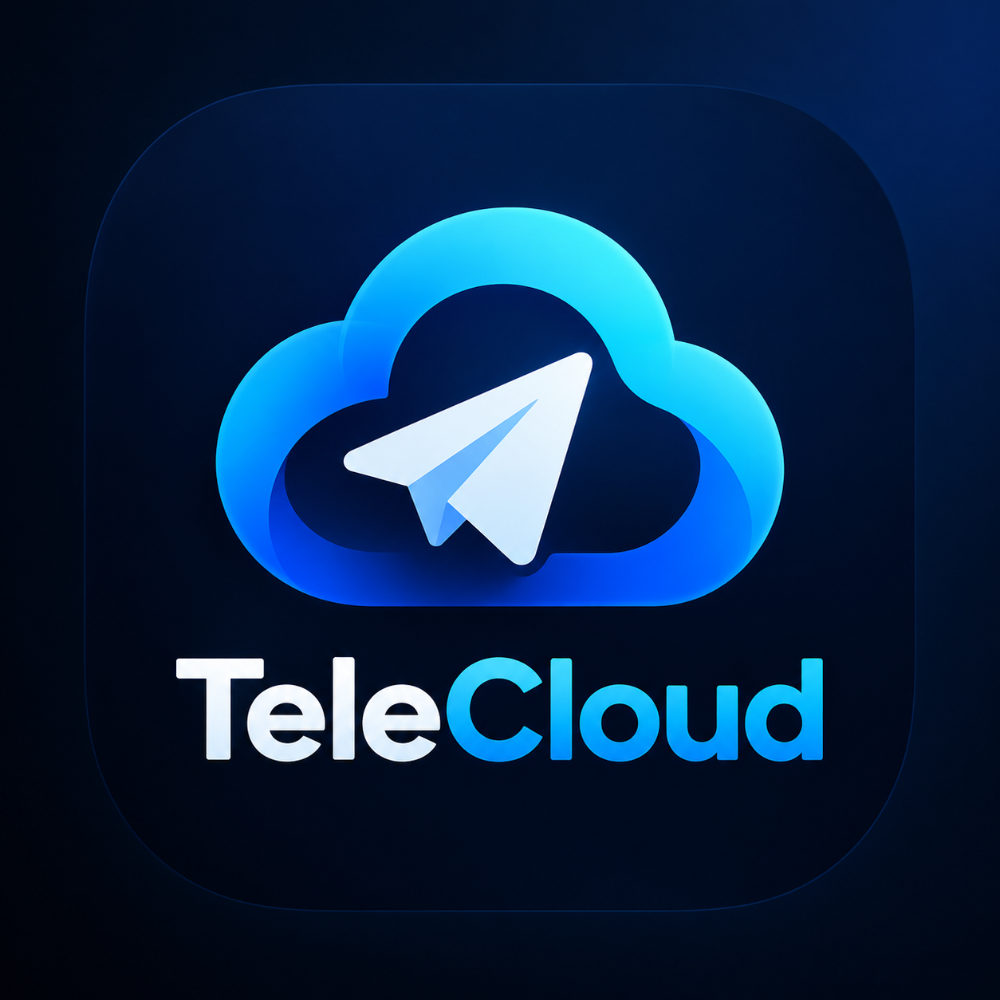

<div align="center">

  

  # TeleCloud

  **Cross-Platform Decentralized Storage Vault Backed by Telegram MTProto & SQLite VFS**

  [](https://tauri.app/)
  [](https://www.rust-lang.org/)
  [](https://react.dev/)
  [](https://www.typescriptlang.org/)
  [](https://github.com/J-DanielWonderson/TeleCloud)
  [](https://workers.cloudflare.com/)

</div>

---

## 📖 Overview

**TeleCloud** is a modern, high-performance desktop and mobile storage vault application. It transforms distributed Telegram MTProto channels into an encrypted, limitless personal cloud drive through a custom virtual file system (VFS), multi-threaded chunking architecture, and local SQLite metadata caching.

Built on **Tauri 2.0** and **Rust**, TeleCloud provides native speed, minimal memory overhead, and true cross-platform capabilities across **Windows x64** and **Android**.

---

## ✨ Key Features

- 🗂️ **Virtual File System (VFS) Explorer:** Seamless hierarchical folder navigation, instant file search, multi-selection, drag-and-drop file organization, and recursive folder downloads.
- ⚡ **Multi-Threaded 512 MB Chunking Engine:** Files of any size are split into streamable, parallelized 512 MB chunks, encrypted, and dispatched across Telegram MTProto connections with intelligent flood-wait guards and bot pool orchestration.
- 💾 **Local SQLite Metadata Cache:** Fast offline browsing and instant directory retrieval powered by an embedded SQLite database that tracks file hierarchy, chunk IDs, MIME types, and sync status.
- 🎨 **Custom Neon Windows Installer:** A bespoke, frameless, animated setup wizard built from scratch with Tauri and React that extracts payload archives, configures standard Windows Program Files directories, registers official Windows Registry Uninstall keys (`HKLM`), and creates Start Menu & Desktop shortcuts.
- 📱 **Native Android Integration:** Built for Android 7.0+ (API 24 to 34+), featuring safe-zone compliant adaptive launcher icons, native JNI bindings (`libtelecloud_vault_lib.so`), and background transfer stability.
- 💬 **Integrated Cloudflare Feedback Relay:** In-app feedback and issue reporting system that communicates with a serverless Cloudflare Worker relay to automatically create and label GitHub Issues without exposing repository tokens in client binaries.

---

## 🛠️ Tech Stack

| Layer | Technologies |
| :--- | :--- |
| **Backend & Core Engine** | [Rust](https://www.rust-lang.org/), [Tauri 2.0](https://tauri.app/), `tokio`, `grammers-client`, `rusqlite` |
| **Frontend UI** | [React 18](https://react.dev/), [TypeScript](https://www.typescriptlang.org/), [Vite 5](https://vitejs.dev/), [Tailwind CSS 3](https://tailwindcss.com/), [Lucide Icons](https://lucide.dev/), [Zustand](https://github.com/pmndrs/zustand) |
| **Storage & Caching** | Embedded SQLite (bundled), Virtual File System abstraction |
| **Feedback Infrastructure**| Cloudflare Workers, TypeScript, Octokit REST API |
| **Target Platforms** | **Windows x64** (Portable `.exe` & Custom Frameless `Setup.exe`), **Android** (arm64-v8a `.apk`) |

---

## 📂 Project Architecture

```
TeleCloud/
├── .github/
│   └── workflows/
│       └── release.yml                 # Automated release workflow (Windows + Android)
├── feedback-relay-worker/              # Cloudflare Worker serverless feedback bridge
│   ├── src/index.ts
│   └── wrangler.toml
├── installer/                          # Custom borderless Windows installer application
│   ├── src/                            # Installer React/TypeScript frontend
│   └── src-tauri/                      # Setup & uninstaller Rust compilation targets
├── scripts/                            # DevOps build and packaging automation scripts
│   ├── build-windows-installer.ps1     # Generates TeleCloud-1.0.0-Setup.exe & portable binary
│   ├── build-android-apk.ps1           # Compiles Rust cdylib & packages Android APK
│   ├── generate-android-icons.ps1      # Safe-zone Android adaptive icon generator
│   └── setup-android-sdk.ps1           # Automated Android SDK/NDK environment bootstrapper
├── src/                                # Main TeleCloud React/TypeScript frontend
├── src-tauri/                          # Main TeleCloud Tauri 2.0 backend (Rust)
│   ├── src/
│   │   ├── engine/                     # Chunk uploader & merger logic
│   │   ├── telegram/                   # MTProto client, bot pools, flood control
│   │   ├── db/                         # SQLite schema and synchronization layer
│   │   └── android_bridge.rs           # JNI bindings for Android
│   └── gen/android/                    # Gradle wrapper and Android project scaffolding
└── release/                            # Packaged distribution binaries (.exe, .apk)
```

---

## 🚀 Local Setup & Development

### 1. Prerequisites

- **Node.js:** LTS version (v18.x or v20.x+) and `npm`
- **Rust:** Stable toolchain (`rustup default stable`)
- **Windows Build Tools:** C++ build tools via Visual Studio Installer
- **Android Development (for Android builds):**
  - Java JDK 17 or 21
  - Android SDK (API Level 34)
  - Android NDK (`26.1.10909125`)
  - Rust Android targets: `rustup target add aarch64-linux-android armv7-linux-androideabi x86_64-linux-android`

### 2. Installation

Clone the repository and install frontend dependencies:

```bash
git clone https://github.com/J-DanielWonderson/TeleCloud.git
cd TeleCloud
npm install
```

### 3. Environment Configuration

Copy the example environment configuration:

```bash
cp .env.example .env
```

Configure your Telegram API credentials (`VITE_TELEGRAM_API_ID`, `VITE_TELEGRAM_API_HASH`) and your deployed Cloudflare feedback relay endpoint (`VITE_FEEDBACK_RELAY_URL`).

### 4. Running the Development Server

Launch the full Tauri desktop development environment:

```bash
npm run tauri dev
```

For frontend-only web UI development in the browser:

```bash
npm run dev
```

---

## 📦 Local Production Build Scripts

TeleCloud utilizes dedicated PowerShell automation scripts in the `scripts/` directory to handle complex multi-phase compilation and asset staging.

### Building Windows Executable & Custom Installer

Executes frontend bundle generation, compiles the main application binary, builds the standalone `uninstall.exe`, packs the compressed payload archive, and produces the custom borderless setup wizard:

```powershell
.\scripts\build-windows-installer.ps1
```

**Outputs generated in `release/`:**
- `release/TeleCloud-1.0.0-Setup.exe` (Self-contained custom installer with UAC elevation)
- `release/TeleCloud.exe` (Standalone portable executable)

### Building Android APK

Compiles the frontend assets, builds the native Rust MTProto shared library (`libtelecloud_vault_lib.so`) for `aarch64-linux-android`, copies web assets and adaptive launcher icons, and runs Gradle release assembly:

```powershell
.\scripts\build-android-apk.ps1
```

**Outputs generated in `release/`:**
- `release/TeleCloud-1.0.0-arm64.apk` (Release APK for ARM64 Android devices)

---

## 📡 Cloudflare Feedback Relay & GitHub Issues

TeleCloud features a built-in user feedback dialog (`FeedbackModal.tsx`) allowing users to report issues, suggest features, or submit bug reports with attached device telemetry and diagnostic logs directly within the app.

```
┌─────────────────┐       HTTPS POST        ┌─────────────────────────┐      GitHub REST API     ┌────────────────────────┐
│  TeleCloud App  │ ──────────────────────> │  Cloudflare Worker      │ ───────────────────────> │  GitHub Repository     │
│ (Desktop/Mobile)│   Feedback Payload      │  (feedback-relay-worker)│   Authenticated Request  │  (Issues & Bug Reports)│
└─────────────────┘                         └─────────────────────────┘                          └────────────────────────┘
```

- **Zero Client Credential Exposure:** Client applications communicate with the Cloudflare Worker serverless endpoint without embedding GitHub personal access tokens.
- **Automated Issue Routing:** The relay worker formats markdown issue templates, applies labels (`feedback`, `bug`, `enhancement`), and files the issue on `J-DanielWonderson/TeleCloud` using serverless GitHub token authentication.

---

## 📄 License

This project is open-source and released under the [MIT License](LICENSE).
